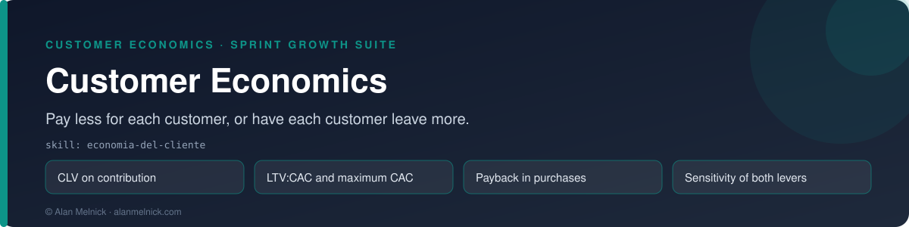
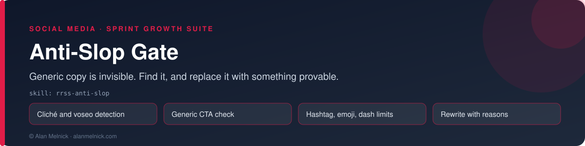

<p align="center"></p>

# Sprint Growth Lite

One free, self-contained skill from each product of the Sprint Growth Suite, for Claude Code, Codex CLI, Cursor, Gemini CLI and any agent that reads `SKILL.md`.

| Product | Free lite skill here | What it does | Full version |
|---|---|---|---|
| Paid Media Director | [pauta-vara-por-objetivo](skills/pauta-vara-por-objetivo/SKILL.md) | Which single number judges each campaign objective, so you stop comparing the wrong metrics. | Agensi |
| Customer Value Analyst | [economia-del-cliente](skills/economia-del-cliente/SKILL.md) | Contribution CLV, LTV:CAC, maximum CAC, payback and a sensitivity table from four inputs. | Agensi |
| SEO and GEO Strategist | [seo-priorizacion-e-impacto](skills/seo-priorizacion-e-impacto/SKILL.md) | Ranks SEO actions by impact x confidence / effort, with ranges instead of promises. | Agensi |
| Social Creative Director | [rrss-anti-slop](skills/rrss-anti-slop/SKILL.md) | Quality gate for social copy: flags generic or AI-sounding writing and rewrites it. | Agensi |
| SEO Value Calculator | [Free web calculator (MIT)](https://github.com/almelnick/calculadora-valor-seo) | What organic search is worth, in three scenarios. The Agensi skill adds the agent-run method and script. | Agensi |

Each skill ships references, an interactive preview you can open in a browser (`preview/preview.html`) and, where it computes, a tested Python script (standard library only, Python 3.9+) with tests.

<p align="center"></p>

## Install

Copy a skill folder into your agent's skills directory, for example:

```bash
cp -r skills/* ~/.claude/skills/
```

Then ask in plain words: "calculate my CLV and maximum CAC" or "review this caption, it sounds generic".

## Run the tests

```bash
python3 skills/economia-del-cliente/tests/test_economia.py
python3 skills/rrss-anti-slop/tests/test_rrss_lint.py
python3 skills/seo-priorizacion-e-impacto/tests/test_seo_priorizar.py
```

## Want the whole suite?

The full Sprint Growth Suite has 15 skills in 4 disciplines: paid media diagnosis and fatigue, customer value (RFM, cohorts), SEO and GEO, and social creative direction. It is sold on Agensi as four bundles plus the SEO Value Calculator. More at [alanmelnick.com](https://alanmelnick.com).

## License

Free to use for your own and your clients' work. Redistribution and resale are not allowed. See [LICENSE.md](LICENSE.md).

<sub>© Alan Melnick · alanmelnick.com. All rights reserved. Created and modified by Alan Melnick; distribution, resale, sharing or republishing, in whole or in part, without his written authorization is prohibited.</sub>
